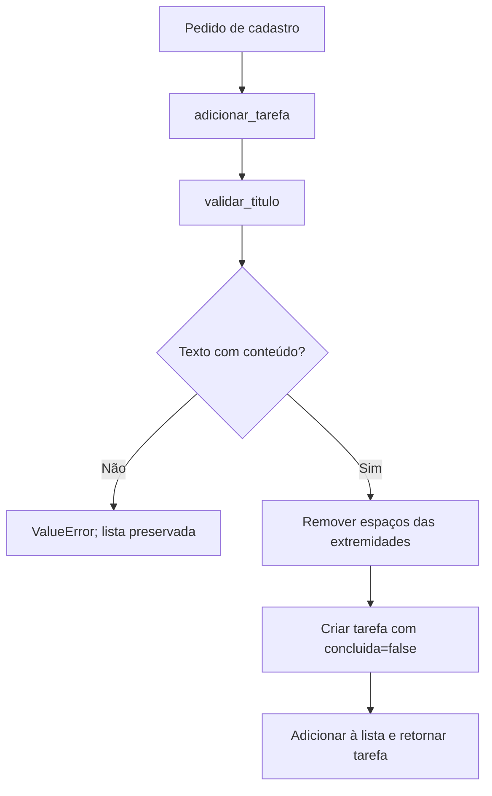

# CEMG Skills

Catálogo pessoal de skills para assistentes compatíveis com Agent Skills. Instale somente as skills que quiser, em Windows, macOS ou Linux, sem copiar configurações de uma máquina para outra.

Repositório publicado como **privado** em [cwgbittencourt/cemg-skills](https://github.com/cwgbittencourt/cemg-skills). A instalação exige acesso autenticado à conta. Consulte [validação e pendências](docs/VALIDACAO.md).

## Catálogo

| Skill | Versão | Finalidade |
|---|---|---|
| [cemg-spec](skills/cemg-spec/SKILL.md) | 1.0.0 | Criar, revisar, atualizar e validar especificações de software usando o template CEMG. |
| [cemg-task-review](skills/cemg-task-review/SKILL.md) | 1.2.1 | Gerar roteiros de revisão de tasks e listar decisões humanas com rastreabilidade no Git. |

Cada pasta em `skills/` é uma unidade de instalação independente. Não é necessário instalar o catálogo inteiro.

A `cemg-task-review` possui uma única fonte compartilhada para Codex, Claude Code, Antigravity e Kiro. Consulte o [guia de instalação por assistente](docs/INSTALACAO-ASSISTENTES.md), com destinos, cópia segura e exemplos de uso.

## Qual skill faz sentido para você?

Desenvolver com IA pode acelerar a escrita do código. Entender a demanda antes de implementar e compreender o resultado antes de aprová-lo continuam exigindo atenção. Este catálogo reúne skills para ajudar nessas duas etapas, com documentos que você pode consultar e revisar no próprio projeto.

| Sua necessidade | Skill indicada | Veja uma entrega antes de instalar |
|---|---|---|
| “Tenho uma ideia, mas preciso esclarecer as regras e o que significa estar pronto.” | `cemg-spec` | [Exemplo de especificação de cadastro de tarefas](docs/exemplos/cemg-spec.md) |
| “A task foi implementada, mas preciso entender o código, suas decisões e o que revisar.” | `cemg-task-review` | [Exemplo de revisão com fluxo e explicação dos métodos](docs/exemplos/cemg-task-review.md) |

Você pode usar cada skill separadamente. A `cemg-task-review` precisa da estrutura de especificações e tasks descrita abaixo; a `cemg-spec` pode trabalhar sobre uma demanda inicial. A `cemg-spec` não cria automaticamente toda essa estrutura de projeto.

### cemg-spec: esclarecer a demanda antes de construir

Uma solicitação como “quero cadastrar tarefas” deixa perguntas abertas: título vazio é permitido? Os dados precisam sobreviver ao encerramento do programa? Como saber que a entrega atende ao pedido? Se essas decisões ficarem implícitas, a implementação pode funcionar tecnicamente e ainda entregar um comportamento diferente do esperado.

A `cemg-spec` ajuda a transformar a demanda em uma especificação verificável: investiga o contexto, explicita regras, relaciona requisitos a critérios de aceite e propõe etapas de implementação. Decisões essenciais sem resposta aparecem como bloqueios; detalhes de baixo risco podem aparecer como suposições explícitas.

**Quando instalar:** ao preparar uma funcionalidade, descrever a correção de um defeito, planejar uma refatoração ou revisar uma especificação com critérios vagos. Tenha a demanda e o contexto disponíveis; acesso ao repositório permite fundamentar melhor as propostas.

**Exemplo de pedido no chat:**

```text
$cemg-spec criar uma função Python para cadastrar tarefas em uma lista em memória.
O título deve ser texto e não pode ficar vazio após remover espaços das extremidades.
Cada tarefa nova começa com concluida=false. Não quero banco nem interface nesta etapa.
Salve a especificação em docs/especificacao-cadastro-tarefas.md.
```

**O que você recebe:** um documento com objetivo, escopo, regras, erros, aceite e plano. Por exemplo, o aceite pode exigir que um título contendo apenas espaços seja recusado sem modificar a lista. Veja o [documento demonstrativo completo](docs/exemplos/cemg-spec.md), incluindo sugestões de pedidos para revisar, atualizar e validar a spec.

A skill organiza a especificação; a classificação de prontidão não comprova que houve implementação ou execução de testes.

### cemg-task-review: compreender a entrega antes de aprovar

A `cemg-task-review` nasceu de uma dificuldade prática: quem implementa uma task precisa entender o que foi realizado e como funciona, mesmo quando boa parte do código foi gerada pela IA. Quem revisa ou mantém esse código também precisa desse entendimento. Se for necessário reconstruir sozinho toda a lógica, parte do tempo ganho na implementação acaba consumida na revisão humana.

O objetivo é diminuir esse esforço ao organizar três respostas: **o que foi criado, como funciona e por que existe**. O roteiro relaciona o pedido à entrega, mostra as chamadas entre componentes e explica os métodos relevantes. Os motivos documentados são separados das inferências técnicas da IA.

**Quando instalar:** ao terminar uma task cujo código ficou difícil de acompanhar, preparar uma passagem de conhecimento ou revisar uma mudança com vários caminhos de execução. Para gerar o roteiro, tenha a task identificada em `specs/<spec>/tasks.md`, os requisitos e o código disponíveis no projeto.

**Exemplo de pedido no chat**, em um projeto demonstrativo com a spec `001-cadastro-tarefas` e a task `T001`:

```text
$cemg-task-review [001] T001
```

**O que você recebe:** um arquivo como `docs/validacao_humana/001-cadastro-tarefas/T001.md`, com matriz solicitado versus entregue, diagrama, explicação dos métodos e checklist para revisão humana.

No exemplo, a função de cadastro chama uma validação antes de modificar a lista. O fluxo torna visíveis tanto o sucesso quanto o caminho de erro:



Esse é o fluxo do [código demonstrativo](docs/exemplos/cadastro_tarefas.py). Abra o [exemplo completo de revisão](docs/exemplos/cemg-task-review.md) para ver a explicação do motivo da validação, as evidências e os pontos que ainda exigem julgamento humano. Em uma revisão real, o diagrama deve refletir o código encontrado.

A skill apoia a compreensão; a decisão de aprovação continua humana. Ela inicia o roteiro como `PENDENTE DE REVISÃO HUMANA`, sem escrever observações em nome do revisor. Os exemplos deste catálogo são materiais didáticos, não registros de homologação de um produto.

## Requisitos

- Codex com suporte a skills pessoais.
- Acesso ao repositório no GitHub; se privado, autenticação com permissão de leitura.
- Python 3.11 ou superior para os comandos de terminal e para a validação deste catálogo.
- Git para a alternativa por clone e para a rastreabilidade de decisões da `cemg-task-review`.

O destino é `$CODEX_HOME/skills` quando `CODEX_HOME` está definido; caso contrário, `~/.codex/skills`. A instalação é feita por usuário e por máquina. Alterar arquivos no clone do catálogo não atualiza automaticamente uma cópia já instalada.

## Instalar uma skill pelo chat do Codex

Envie no chat:

```text
$skill-installer instale a skill cemg-task-review do repositório cwgbittencourt/cemg-skills, caminho skills/cemg-task-review, branch main.
```

Essa é uma instrução para o Codex usar o instalador disponível no ambiente. Não é um comando de terminal. Se o instalador não estiver disponível, use a instalação manual abaixo.

## Instalar uma skill pelo terminal

Os exemplos usam o instalador que acompanha o Codex em `skills/.system/skill-installer`. Se esse arquivo não existir na sua distribuição, use a alternativa por clone.

### Windows — PowerShell

```powershell
$codexDir = if ($env:CODEX_HOME) { $env:CODEX_HOME } else { Join-Path $HOME '.codex' }
$installer = Join-Path $codexDir 'skills/.system/skill-installer/scripts/install-skill-from-github.py'
python $installer --repo cwgbittencourt/cemg-skills --path skills/cemg-task-review
```

### macOS e Linux — Bash/Zsh

```bash
codex_dir="${CODEX_HOME:-$HOME/.codex}"
installer="$codex_dir/skills/.system/skill-installer/scripts/install-skill-from-github.py"
python3 "$installer" --repo cwgbittencourt/cemg-skills --path skills/cemg-task-review
```

### O que cada argumento faz

| Argumento | Função |
|---|---|
| `--repo cwgbittencourt/cemg-skills` | Seleciona o repositório de origem. |
| `--path skills/cemg-task-review` | Instala somente essa pasta e seus recursos. |
| `--ref main` | Seleciona a branch; `main` é o padrão. Também aceita tag ou commit. |
| `--dest CAMINHO` | Define outra pasta de destino; útil para testar sem alterar a instalação pessoal. |
| `--method auto` | Tenta download e, em situações de autenticação compatíveis, recorre ao Git. |
| `--method git` | Usa Git; útil quando o acesso ao repositório privado já está configurado no Git. |

Para fixar a versão histórica publicada, acrescente `--ref cemg-task-review-v1.2.0`. A [release 1.2.0](https://github.com/cwgbittencourt/cemg-skills/releases/tag/cemg-task-review-v1.2.0) também oferece o ZIP original. A instalação real anterior por `main` e pela tag foi verificada no Windows com `--method git`. A adaptação `1.2.1` está na fonte local; a tag `cemg-task-review-v1.2.0` continua entregando a versão original.

O instalador recusa um destino já existente. Para atualizar, siga a seção de atualização. A skill deve ficar disponível no próximo turno; se não aparecer, reinicie o Codex e confira o diretório de instalação.

## Instalação manual a partir de um clone

Para obter uma cópia local:

```text
git clone https://github.com/cwgbittencourt/cemg-skills.git
cd cemg-skills
```

Se você já possui esta pasta local, execute os comandos de cópia a partir da raiz dela, sem clonar novamente.

### Windows — PowerShell

```powershell
$codexDir = if ($env:CODEX_HOME) { $env:CODEX_HOME } else { Join-Path $HOME '.codex' }
$skillsDir = Join-Path $codexDir 'skills'
$destination = Join-Path $skillsDir 'cemg-task-review'
if (Test-Path -LiteralPath $destination) { throw 'A skill já existe. Siga a seção Atualizar.' }
New-Item -ItemType Directory -Path $skillsDir -Force | Out-Null
Copy-Item -LiteralPath './skills/cemg-task-review' -Destination $destination -Recurse
```

### macOS e Linux — Bash/Zsh

```bash
codex_dir="${CODEX_HOME:-$HOME/.codex}"
destination="$codex_dir/skills/cemg-task-review"
if [ -e "$destination" ]; then
  printf '%s\n' 'A skill já existe. Siga a seção Atualizar.'
else
  mkdir -p "$codex_dir/skills"
  cp -R ./skills/cemg-task-review "$destination"
fi
```

Copie a pasta completa, incluindo `agents/`, `assets/` e `references/`. Não copie `packages/`, `.git/` nem o README para dentro da skill.

## Comandos da cemg-spec

Envie os comandos no **chat do Codex**, no projeto que será especificado:

| Comando | Finalidade |
|---|---|
| `$cemg-spec criar <demanda>` | Investigar a demanda e produzir uma especificação. |
| `$cemg-spec revisar <arquivo ou conteúdo>` | Apontar lacunas, contradições e correções propostas. |
| `$cemg-spec atualizar <spec> <mudanças>` | Incorporar mudanças preservando IDs e registrando impactos. |
| `$cemg-spec validar <spec>` | Avaliar a prontidão para implementação; aceita também “verificar prontidão”. |

A skill utiliza o modelo canônico incluído em sua pasta e classifica a spec como pronta, pronta com suposições explícitas ou bloqueada por decisões essenciais. Sua função é investigar e documentar; prontidão não significa implementação concluída.

Para instalar pelo chat após a publicação:

```text
$skill-installer instale a skill cemg-spec do repositório cwgbittencourt/cemg-skills, caminho skills/cemg-spec, branch main.
```

Nos exemplos de instalação pelo terminal, cópia manual e atualização deste README, substitua `cemg-task-review` por `cemg-spec` para selecionar esta skill.

## Comandos da cemg-task-review

Os comandos desta seção são enviados no **chat do Codex**, aberto no projeto que será revisado. Não os execute no terminal.

### Gerar e salvar uma revisão

```text
$cemg-task-review [001] T015
```

- `001`: prefixo da especificação em `specs/`, preservando zeros; colchetes são opcionais.
- `T015`: identificador da task em `tasks.md` daquela especificação.
- Também aceita o nome completo da pasta: `$cemg-task-review 001-entrega-validada T015`.

A skill analisa requisitos e implementação e salva o roteiro em `docs/validacao_humana/<pasta-da-spec>/T015.md`, preservando `Docs` quando esse for o padrão existente. Se já houver revisão, cria outra com data e hora, preservando a anterior.

O documento inicia com `PENDENTE DE REVISÃO HUMANA` e observações humanas vazias. A pessoa revisora altera manualmente `status` e `observacoes_humanas` e faz commit. A skill não aprova a task nem altera seu planejamento.

### Listar todas as revisões do projeto

```text
$cemg-task-review listar
```

Consulta os documentos existentes e o histórico local do Git. Mostra status, arquivo e, quando comprováveis no histórico, autor declarado, data e commit da última alteração dos campos humanos. Não cria uma nova revisão.

### Listar as revisões de uma especificação

```text
$cemg-task-review listar [001]
```

Filtra pelo prefixo ou nome da especificação. Não exige que a pasta original em `specs/` continue existindo.

### Aliases textuais

```text
/CEMG-task-review [001] T015
/CEMG-task-review listar
/CEMG-task-review listar [001]
```

Essas formas expressam a mesma intenção no chat do Codex. No Claude Code, use `/cemg-task-review [001] T015`. No Antigravity e no Kiro, peça “Use a skill cemg-task-review para revisar a task T015 da spec 001”. O registro de comandos e o menu dependem do assistente; consulte o guia de instalação por assistente.

### Pré-requisitos e limites da revisão

A geração usa `specs/<spec>/tasks.md`, os requisitos e a implementação do projeto atual. Uma identificação ambígua exige esclarecimento. A listagem usa os documentos já salvos e o Git local; histórico ausente ou incompleto limita a atribuição da decisão. Autor declarado no Git não comprova identidade nem edição manual. Testes do projeto só são executados quando autorizados no pedido.

## Atualizar ou remover

Antes de atualizar, compare personalizações locais com a nova versão. Mova a instalação existente para um backup **fora de `skills/`**, e então instale a nova versão usando um dos métodos acima. O backup externo evita que duas cópias da skill sejam descobertas pelo Codex.

Para atualizar o clone do catálogo, use `git pull --ff-only` com a árvore de trabalho limpa. Isso não atualiza as skills pessoais: depois, repita a cópia ou o instalador.

Para remover de forma reversível, use o mesmo procedimento de mover para backup e não reinstale:

### Windows — PowerShell

```powershell
$codexDir = if ($env:CODEX_HOME) { $env:CODEX_HOME } else { Join-Path $HOME '.codex' }
$source = Join-Path $codexDir 'skills/cemg-task-review'
$backupRoot = Join-Path $codexDir 'skill-backups'
$backup = Join-Path $backupRoot ('cemg-task-review-' + (Get-Date -Format 'yyyyMMdd-HHmmss-fff'))
if (-not (Test-Path -LiteralPath $source)) { throw 'Skill não instalada nesse destino.' }
if (Test-Path -LiteralPath $backup) { throw 'Backup já existe; escolha outro nome.' }
New-Item -ItemType Directory -Path $backupRoot -Force | Out-Null
Move-Item -LiteralPath $source -Destination $backup
```

### macOS e Linux — Bash/Zsh

```bash
codex_dir="${CODEX_HOME:-$HOME/.codex}"
source_dir="$codex_dir/skills/cemg-task-review"
if [ -d "$source_dir" ]; then
  mkdir -p "$codex_dir/skill-backups"
  backup_container="$(mktemp -d "$codex_dir/skill-backups/cemg-task-review.XXXXXX")"
  mv "$source_dir" "$backup_container/cemg-task-review"
else
  printf '%s\n' 'Skill não instalada nesse destino.'
fi
```

Se a nova instalação falhar, restaure a pasta do backup para o caminho original, desde que ele esteja livre. Não mescle versões automaticamente. Reinicie o Codex se a descoberta não refletir a alteração. As revisões em `docs/validacao_humana` pertencem aos projetos e permanecem disponíveis.

## Solução de problemas

| Problema | O que conferir |
|---|---|
| `Destination already exists` | Preserve a instalação existente conforme a seção de atualização. |
| Skill não aparece | Confira `CODEX_HOME`, a existência de `skills/cemg-task-review/SKILL.md` e se houve uma pasta extra ao extrair o ZIP. |
| Repositório não encontrado | Confirme a publicação, a URL e a permissão de leitura. |
| Repositório privado | Configure as credenciais Git da sua conta e tente `--method git`; o instalador também aceita `GH_TOKEN` ou `GITHUB_TOKEN` no ambiente. Não salve tokens neste repositório. |
| `python` não encontrado | Instale Python 3.11+ ou use `py -3` no Windows / `python3` no macOS e Linux. |
| Histórico de decisão insuficiente | Consulte a revisão em um clone com o histórico necessário; a skill não faz `fetch` automaticamente. |

## Adicionar e validar novas skills

1. Crie `skills/<nome-da-skill>/SKILL.md` com `name`, `description` e `metadata.version` entre delimitadores YAML `---`.
2. Use nome em minúsculas, números e hífens, igual ao da pasta, com menos de 64 caracteres.
3. Inclua recursos com links relativos internos à própria skill. Não dependa de caminhos da máquina de origem.
4. Adicione a skill e a versão à tabela do catálogo e documente cada comando nesta página.
5. Explique o problema que a skill resolve, quando instalá-la, seus pré-requisitos e limites. Inclua um pedido simples e um exemplo de entrega em `docs/exemplos/`, identificado como demonstrativo. Mostre um fluxo visual quando ele ajudar a entender o resultado.
6. Execute a validação e os testes antes de publicar.

```text
python -m pip install -r requirements-dev.txt
python scripts/validate_skills.py
python -m unittest discover -s tests -v
```

No macOS/Linux, substitua `python` por `python3` se necessário. A dependência PyYAML é usada apenas na manutenção; instalar a skill não exige instalar as dependências deste catálogo.

O GitHub Actions executa essas verificações em Windows, macOS e Linux. A validação cobre metadados, YAML, recursos, links, caminhos locais e o catálogo. Ela não comprova o julgamento da skill durante uma revisão real.

## Versões, pacotes e publicação

Cada skill mantém sua versão em `metadata.version`; o catálogo deve mostrar o mesmo valor. Use tags como `cemg-task-review-v1.2.0` para versões imutáveis publicadas de uma skill. Mudanças somente na documentação do catálogo não exigem mudar a versão da skill.

O pacote original foi preservado em [packages/cemg-task-review](packages/cemg-task-review), incluindo as instruções originais. A fonte de manutenção passa a ser a pasta descompactada em `skills/`; o ZIP original é histórico e não é atualizado automaticamente. Novos ZIPs de releases devem ser gerados a partir da fonte correspondente à tag.

Consulte o [procedimento de publicação](docs/PUBLICACAO.md) e o [registro de validação](docs/VALIDACAO.md).

## Licença

A licença de distribuição ainda não foi escolhida pelo titular. Este catálogo não concede, por enquanto, uma licença aberta de redistribuição. Defina a licença antes de disponibilizar o projeto publicamente.
