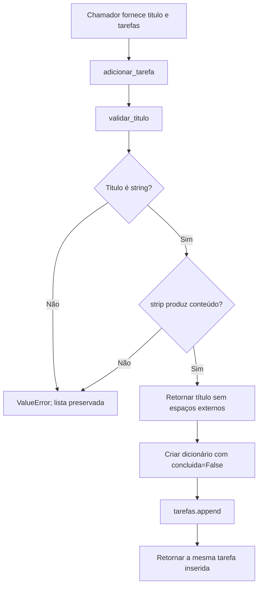

# Exemplo de entrega: cemg-task-review

**Demonstração do formato e do conteúdo esperado.** Este roteiro foi escrito para o catálogo com base no [código didático disponível](cadastro_tarefas.py) e na [especificação demonstrativa](cemg-spec.md). Não é uma revisão de uma task real deste repositório, uma homologação nem evidência de execução automática da skill.

[Voltar ao catálogo](../../README.md)

## Pedido e arquivo que seriam gerados

Em um projeto que contenha `specs/001-cadastro-tarefas/spec.md`, `tasks.md` com a T001 e o módulo implementado, o pedido seria:

```text
$cemg-task-review [001] T001
```

O destino seria `docs/validacao_humana/001-cadastro-tarefas/T001.md`. Esta prévia está em `docs/exemplos/` para não aparecer como uma decisão humana do catálogo. Os commits estão como `null`: nenhum intervalo de entrega foi atribuído ao cenário.

---

# Roteiro de Revisão Guiada da Task: T001 — cadastrar tarefas

**Status na geração:** PENDENTE DE REVISÃO HUMANA  
**Escopo:** as funções `validar_titulo` e `adicionar_tarefa` do módulo didático.  
**Independência:** limitada; exemplo e explicação foram preparados pela mesma instância.  
**Alterações locais:** não avaliadas como entrega de uma task real.  
**Limite da evidência:** leitura do código demonstrativo, sem histórico de implementação atribuído e sem suíte de testes do produto.

## Decisão humana

O roteiro inicia com `status: "PENDENTE DE REVISÃO HUMANA"` e `observacoes_humanas: ""`. Em uso real, a pessoa revisora edita manualmente esses campos e faz commit. A listagem consulta o Git para localizar o registro; o checklist não altera o status automaticamente.

## 1. Visão geral: o que foi implementado?

A T001 deste exemplo recebe um título e uma lista, valida o título, cria uma tarefa pendente e a adiciona à lista. O objetivo é evitar registros sem conteúdo e dar um estado inicial previsível às tarefas.

| Solicitado | Observação na implementação | Evidência |
|---|---|---|
| Cadastrar e retornar uma tarefa válida. | ENTREGUE no código demonstrativo; execução funcional ainda precisa ser validada pelo revisor. | `adicionar_tarefa`, [linhas 10–14](cadastro_tarefas.py#L10-L14). |
| Recusar texto vazio e valores não textuais antes de modificar a lista. | ENTREGUE no código demonstrativo. A validação ocorre antes de `append`. | `validar_titulo`, [linhas 4–7](cadastro_tarefas.py#L4-L7), e sua chamada na linha 11. |
| Remover espaços nas extremidades e iniciar como não concluída. | ENTREGUE no código demonstrativo. | Retorno de `strip()` na linha 7; criação do registro na linha 12. |
| Comprovar os critérios de aceite com testes. | NÃO COMPROVADO por esta revisão demonstrativa. | A especificação propõe CA-001 a CA-003; este roteiro não apresenta resultados de uma suíte executada. |

Os dois métodos são **novos no cenário didático**. Não houve comparação com um commit de uma aplicação real para atribuir origem ou cronologia.

## 2. Fluxo entre métodos: como as partes se conectam?



A posição da validação é relevante: o erro interrompe a função antes da alteração da lista. Um valor como `None` é recusado pela primeira condição, sem executar `strip()` sobre ele.

## 3. Métodos: o que fazem, como e por quê?

### validar_titulo — validar antes de criar

**Onde revisar:** [cadastro_tarefas.py, linha 4](cadastro_tarefas.py#L4).

**O que faz:** aceita somente strings que tenham conteúdo após retirar espaços das extremidades e devolve o título normalizado.

**Como faz:** primeiro usa `isinstance(titulo, str)`. O operador `or` interrompe a avaliação se o tipo for inválido. Para strings, verifica `titulo.strip()`; se o resultado for vazio, lança `ValueError`. Caso contrário, retorna o resultado de `strip()`.

**Por que existe:** evita tarefas sem título útil e centraliza a normalização. A validação e o comportamento de remoção de espaços estão documentados em RN-001 e RN-002 da especificação demonstrativa. A escolha de uma função auxiliar é uma **inferência técnica da IA sobre a organização do código**, não uma exigência de negócio.

**Pontos de atenção:** não há limite de tamanho nem recusa de títulos duplicados; são premissas explícitas deste cenário. Se o produto exigir essas regras, a especificação e a implementação precisam mudar juntas.

**Evidências de testes:** não há resultado de suíte registrado neste roteiro. Validar títulos com conteúdo, espaços, string vazia e valores não textuais.

### adicionar_tarefa — criar, inserir e retornar

**Onde revisar:** [cadastro_tarefas.py, linha 10](cadastro_tarefas.py#L10).

**O que faz:** cria uma tarefa não concluída, insere na lista fornecida e retorna a tarefa criada.

**Como faz:** chama `validar_titulo`, monta um dicionário com `titulo` e `concluida`, chama `tarefas.append(tarefa)` e retorna o mesmo objeto. Não grava arquivos nem consulta serviços externos.

**Por que existe:** implementa o cadastro e o estado inicial descritos por RF-001 e RN-003. Executar a validação antes da inserção atende à preservação da lista exigida por RF-002. Essas justificativas são **documentadas no requisito demonstrativo**.

**Pontos de atenção:** a função pressupõe uma lista válida e compartilha a referência do dicionário com o chamador. Alterar o dicionário retornado também altera o registro na lista. O armazenamento desaparece ao encerrar o programa, conforme o escopo em memória.

**Evidências de testes:** confirmar que a lista ganha exatamente um registro no sucesso e permanece igual nos erros. Conferir conscientemente se a referência compartilhada atende ao uso esperado.

## 4. Checklist de validação humana recomendado

- [ ] Ler RN-001 a RN-003 e confirmar que correspondem ao comportamento desejado.
- [ ] Verificar CA-001: título normalizado, estado inicial e retorno corretos.
- [ ] Verificar CA-002 e CA-003: erro esperado e lista preservada.
- [ ] Confirmar que ausência de persistência, limite e deduplicação faz sentido nesta etapa.
- [ ] Confirmar se o objeto retornado pode compartilhar referência com a lista.
- [ ] Registrar resultados dos testes antes de decidir sobre aprovação.

## Limites e próximos passos

O diagnóstico do exemplo é que o código representa o comportamento principal solicitado, mas esta leitura não comprova a execução dos critérios de aceite. O risco principal para adaptação a um produto é transportar as premissas simplificadas sem revisá-las. A validação recomendada é executar os casos de aceite e revisar as premissas; não foi realizada uma correção de produto neste roteiro.

Após a revisão real, a pessoa registra a decisão nos campos humanos e faz commit. `$cemg-task-review listar [001]` consulta esse registro no projeto. A skill distingue alterações locais, criação do roteiro e mudanças dos campos humanos; autor declarado no Git não comprova identidade.
