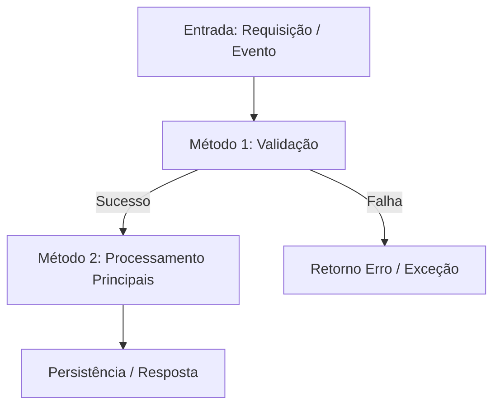

# Roteiro de Revisão Guiada da Task: [Nome/ID da Task]

> **Data:** AAAA-MM-DD  
> **Escopo da Análise:** `[Branch / Diff / Commit Range]`  
> **Independência da revisão:** `[Independente / Limitada, com motivo]`  
> **Alterações locais:** `[Estado observado da árvore de trabalho]`  
> **Status na geração:** `PENDENTE DE REVISÃO HUMANA`

---

## Decisão humana

O revisor altera manualmente `status` e `observacoes_humanas` no cabeçalho YAML e faz commit.
Status permitidos: `PENDENTE DE REVISÃO HUMANA`, `EM REVISÃO HUMANA`, `APROVADO`,
`APROVADO COM RESSALVAS` e `REPROVADO`. Para ressalvas ou reprovação, registrar seus motivos
nas observações. Responsável declarado, data e commit da decisão serão consultados no Git
pelo modo `listar`; não preencher esses dados manualmente nem atribuir identidade por suposição.
O checklist abaixo é apoio, não altera status automaticamente nem promove a task no planejamento.

## 1. Visão Geral da Task (O que foi implementado?)

### Resumo do Objetivo
[Descrição clara do comportamento de ponta a ponta adicionado ou modificado].

### Matriz Solicitado vs Entregue
| Requisito Solicitado | Status na Implementação | Evidência no Código |
|---|---|---|
| [Requisito 01] | `[ENTREGUE]` | `src/path/file.ts:L15` |
| [Requisito 02] | `[PARCIAL / DIVERGENTE]` | `src/path/file2.ts:L40` |

---

## 2. Fluxo de Execução entre Métodos (Como as partes trabalham juntas?)

---

## 3. Detalhamento dos Métodos Relevantes

### 3.1. Método / Componente: `[NomeDoMetodoOuClasse]`

- **Arquivo:** `path/para/arquivo.ext` (Linhas X-Y)
- **O que faz:** [Verificação ou ação executada pelo método].
- **Como faz:** [Passo a passo interno: consultas, loops, transformações e regras de negócio].
- **Por que existe:** [Motivação da criação/alteração].
- **Origem da Justificativa:** `[Documentada no Requisito | Convenção do Projeto | Inferência Técnica da IA]`
- **Onde revisar (Pontos de Atenção):**
  - ⚠️ *Concorrência / Performance:* [Atenção necessária].
  - ⚠️ *Tratamento de Exceções:* [Como o erro é tratado].
- **Evidências de Testes:** `tests/path/test.spec.ts` (Cobrado / Ausente).

---

## 4. Checklist de Validação Humana Recomendada

- [ ] **Alinhamento de Negócio:** O comportamento entregue atende integralmente à dor do usuário?
- [ ] **Casos Limite (Edge Cases):** Foram validados dados nulos, arrays vazios e timeouts?
- [ ] **Segurança e Permissões:** Houve exposição indevida de dados ou falha de autorização?
- [ ] **Manutenibilidade:** As abstrações criadas fazem sentido para a arquitetura global?
